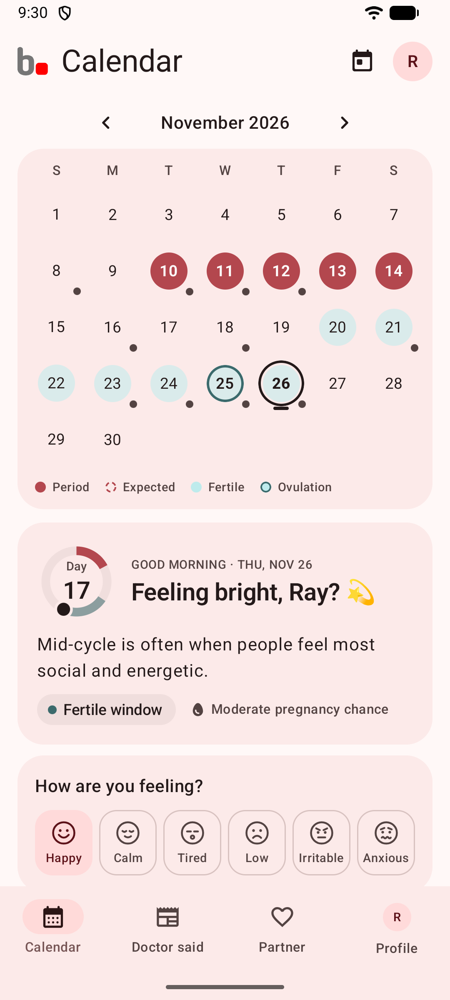
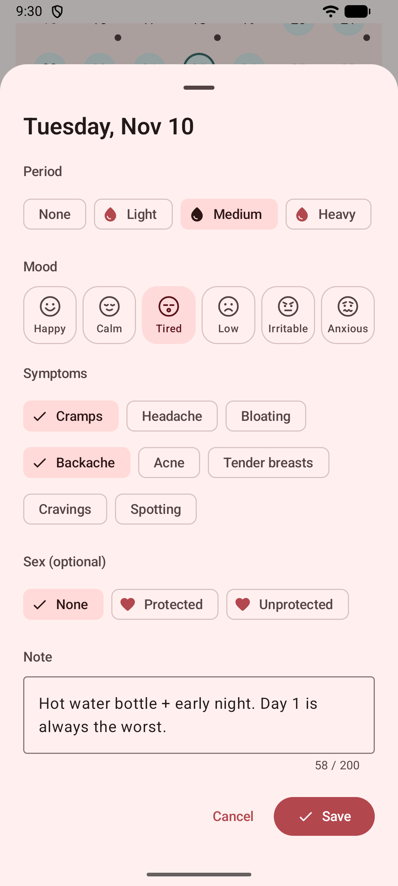
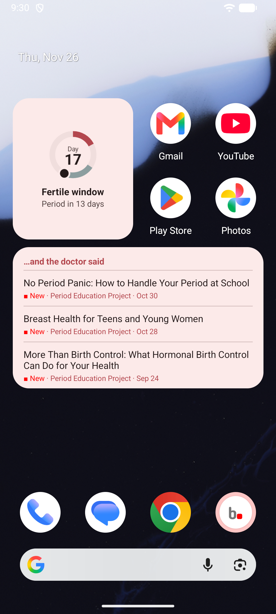
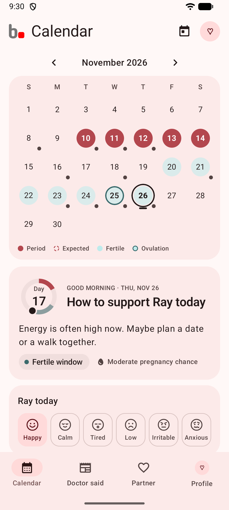

# Publishing on F-Droid

F-Droid builds the app from this repository's source on its own servers. Our build is
**reproducible**: F-Droid's build comes out byte-for-byte identical to the APK in our GitHub
release, so F-Droid publishes *our* signed APK (`Binaries:` + `AllowedAPKSigningKeys:` in the
metadata). People can then move between GitHub and F-Droid versions without reinstalling.

## What's ready in this repo

| | |
|---|---|
| `fastlane/metadata/android/en-US/` | everything F-Droid shows: `title.txt`, `short_description.txt` (≤ 80 characters), `full_description.txt`, `changelogs/<versionCode>.txt` (≤ 500), `images/icon.png` (512×512), `images/featureGraphic.png` (1024×500), `images/phoneScreenshots/1…11.png` |
| `app/build.gradle.kts` | `dependenciesInfo` off (F-Droid rejects the Google-signed dependency block); `vcsInfo` off in release (git details would differ between our Docker build and F-Droid's git clone and break reproducibility); release builds are unsigned unless a key is given |
| `settings.gradle.kts` | no `foojay-resolver` plugin (it can download a JDK during the build; F-Droid's scanner refuses it) |
| License, source, tags | GPL-3.0, public on GitHub, one `vX.Y.Z` tag per release |

Checked here with F-Droid's own tools (`fdroidserver` 2.4.6): `fdroid lint` and `fdroid rewritemeta`
pass on the metadata below, and the source scanner finds no problems. A release APK built on a
desktop (JDK 25, from git) and one built in our `Dockerfile` (JDK 21, no git) are byte-identical.

Screenshots were taken on the emulator with made-up data ("Ray"), never real data (see
"Screenshots" below).

**Every release:** bump `versionName`/`versionCode`, add
`fastlane/metadata/android/en-US/changelogs/<versionCode>.txt`, tag `vX.Y.Z`. F-Droid picks up the
tag by itself (`UpdateCheckMode: Tags`), builds it, compares it with the APK in our GitHub release
and publishes ours. **Don't change how the release APK is built** (Dockerfile versions, Gradle
settings) without checking it stays reproducible: if F-Droid's build differs, that version isn't
published.

## The metadata file (fdroiddata: `metadata/site.brutt.betterRed.yml`)

```yaml
Categories:
  - Health Manager
License: GPL-3.0-only
AuthorName: bruttazz
AuthorWebSite: https://brutt.site
SourceCode: https://github.com/bRuttaZz/better-red
IssueTracker: https://github.com/bRuttaZz/better-red/issues
Changelog: https://github.com/bRuttaZz/better-red/releases

AutoName: Better Red

RepoType: git
Repo: https://github.com/bRuttaZz/better-red.git
Binaries: https://github.com/bRuttaZz/better-red/releases/download/v%v/better-red-%v.apk

Builds:
  - versionName: 1.2.2
    versionCode: 4
    commit: <full 40-character hash of the v1.2.2 commit: git rev-parse v1.2.2^{commit}>
    subdir: app
    gradle:
      - yes

AllowedAPKSigningKeys: 6421556051b54fda08a480c1b6382f975744927d649d181162fb93e76025ec17

AutoUpdateMode: Version
UpdateCheckMode: Tags
CurrentVersion: 1.2.2
CurrentVersionCode: 4
```

- `AllowedAPKSigningKeys` is the SHA-256 of our release signing certificate (also printed in every
  GitHub release's notes). It never changes while we keep the same key.
- `commit` must be the full hash, not the tag name.
- "Health Manager" is F-Droid's category for menstruation trackers (`config/categories.yml`).

## The merge request text

Title: `New app: Better Red`. Paste the "App inclusion" template and fill it as below.

> ## Abstract for new app inclusion
>
> ### Please introduce the functions and usage of your app in summary, and also attach some screenshots.
>
> Better Red is a simple, private period tracker. No account, no cloud, no analytics: everything
> is stored in one SQLite file on the phone, which can be exported and imported.
>
> - Period calendar with the next period, ovulation and fertile window, predicted from the user's
>   own logged cycles
> - Log flow, mood, symptoms and a short note per day
> - A daily message for the cycle phase; fertility details can be hidden
> - Cycle and article widgets that follow light/dark mode
> - "…and the doctor said": articles from women's-health non-profits (RSS) with a reader view
> - Optional partner sharing: the partner sees what she chooses (view only), paired in person by
>   QR code, end-to-end encrypted, through a small self-hostable relay that can't read the data
>
> Screenshots (from the repo's fastlane folder):
>
> 
> 
> 
> 
>
> ### Please elaborate why you wrote this app. Please highlight the unique functions it provides over other similar apps in F-Droid.
>
> I wrote it for my partner, who wanted a period tracker that keeps her data on her phone and is
> pleasant to use. What it adds:
>
> - **Private partner sharing**: a view-only partner app mode, paired in person by QR code with
>   no accounts, end-to-end encrypted (P-256 ECDH + AES-GCM). The relay
>   ([better-red-broker](https://github.com/bRuttaZz/better-red-broker), GPL-3.0) only stores
>   padded, encrypted blobs, can be self-hosted (optionally with a password), and only ever holds
>   the last 60 days.
> - **Women-first wording**: a daily message for her cycle phase; pregnancy chance is a quiet
>   secondary line and can be hidden.
> - **Home screen widgets** and a built-in reader for women's-health articles from non-profits.
> - Small (about 4 MB), no tracking, everything in one exportable SQLite file.
>
> Network use: the RSS feeds, and only if enabled, partner sharing through the default relay
> `better-red.brutt.site` (free software, self-hostable), so I don't think NonFreeNet applies.
>
> (then the checklist, see below)

## The checklist, item by item

**Policy**
- Inclusion policy: free software, no non-free dependencies, no tracking or ads. ✔
- **Quality point 6** ("actively developed for at least 3 months"): the repository started on
  2026-11-23. Unless an exception applies (proven users, or the author already maintains other
  F-Droid apps), either wait until about 2027-02-23 or submit now and say so plainly in the MR;
  reviewers may then keep it open until the 3 months have passed. Don't tick it if it isn't true.
- Original author notified: we are the author. ✔
- Fastlane folder with en-US summary, description, icon, images, changelog. ✔

**Docs** (read them; the metadata above follows the Gradle template and passes `fdroid lint`). ✔

**Merge request setup**
- Title `New app: Better Red`. ✔
- Fork public, new branch (branches other than the default aren't protected). ✔
- No related issues or RFP: delete the `Closes rfp#<RFP issue number>` line; keep
  `/label ~"New App"`. ✔
- One app. ✔

**Metadata**
- `metadata/site.brutt.betterRed.yml`, valid YAML, LF line endings (GitLab's web editor uses LF). ✔
- No summary/description/images in fdroiddata: they come from our fastlane folder. Check the MR's
  Changes tab shows only that one file. ✔
- Tags + `AutoUpdateMode: Version` / `UpdateCheckMode: Tags`. ✔
- Issue tracker, author website, `AuthorName`. ✔ (An `AuthorEmail` is optional; only add one if
  you want it public.)
- No external repos / submodules / srclibs. ✔
- **Reproducible builds**: enabled (`Binaries` + `AllowedAPKSigningKeys`). ✔
- **ABI split**: not needed: one universal APK of about 4 MB, of which native libraries (CameraX,
  AndroidX graphics) are about 200 KB. Write that in the MR.
- Only the latest version, no disabled versions, `commit` is the full hash. ✔

**Pipeline** (after opening the MR): all pipelines pass, Reports tab warnings fixed or explained.
If GitLab asks for a phone number or card, don't give one: leave a note in the MR so the F-Droid
team runs the pipeline.

## Good to know

- F-Droid publishes our signed APK, so updates move freely between GitHub and F-Droid installs.
- The app ID is `site.brutt.betterRed`; it can never change once published.
- To check reproducibility yourself: build the tag on a desktop
  (`./gradlew assembleRelease` with no signing key) and compare with the GitHub APK:
  `apksigcopier compare better-red-X.apk --unsigned app/build/outputs/apk/release/app-release-unsigned.apk`
  (`pip install apksigcopier`; needs `apksigner` from the Android SDK build-tools on `PATH`).

## Screenshots

Taken on the "Medium Phone API 37" emulator (1080×2400) with a debug build:

1. Install the debug APK, open it once, then fill its database with sample data: pull
   `databases/better_red.db` with `adb exec-out run-as site.brutt.betterRed cat …`, insert
   made-up `day_log` rows and settings (`name`, `theme`), push it back with `adb exec-in run-as …`.
2. Clean status bar: `adb shell settings put global sysui_demo_allowed 1`, then
   `adb shell am broadcast -a com.android.systemui.demo -e command enter` (and `clock -e hhmm 0930`,
   `battery -e level 100`, `notifications -e visible false`).
3. `adb exec-out screencap -p > N.png` for each screen; widgets are added from the launcher's
   widget picker. Don't include screenshots of article pages with people's photos.
