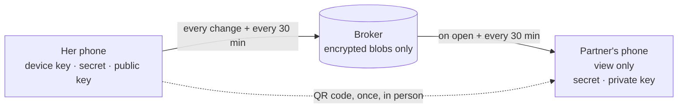
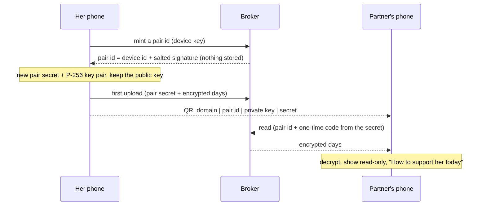
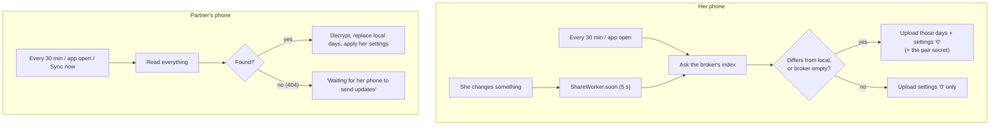

# Partner sharing

Her partner can see what she chooses to share: always her period dates, and optionally her mood,
fertility, symptoms and notes. The partner can look, never change. Sex is never shared.

The data goes through a small relay, the **broker** (`../better-red-broker`, Go). It's a dumb,
disposable cache: it stores only end-to-end encrypted blobs it can't read, and if it loses them her
phone writes them again. The broker's own docs go deeper: `design.md` (the whole flow),
`protocol.md` (API, formats, crypto), `security.md`, `operations.md`.



## The ideas, in short

- **Her phone is the source of truth.** The broker is a mailbox; if it's down, both apps keep
  working and only the partner's view pauses. If it loses its data, her next sync refills it.
- **No accounts.** A phone is a random 32-byte device key (table `device`); the broker sees its hash
  inside the pair id and never stores the key.
- **Pairing is in person**: her phone shows a QR code (server domain, pair id, pair secret, private
  key); the partner's phone scans it (camera or a screenshot from the gallery). Nobody else,
  including the server, can read.
- **She's in control**: switches for what's shared; "Stop sharing" deletes the server copy; "New
  pairing code" replaces the partner (with a warning first). Only the last 60 days are ever shared.
- **Default server** `better-red.brutt.site`, already filled in; she can change it (domain only),
  but is never asked to.

## Pairing



## Roles on the phone

`device.role`:

- `null`: not paired (the Partner tab offers "Show pairing code").
- `PUBLISHER`: her phone, sharing. Keeps the device key, the pair secret and the **public** share key.
- `PARTNER`: the partner's phone (chosen at onboarding with "For my partner"). Keeps the pair secret
  and the **private** share key. The whole app is view-only: no edit buttons, the mood row can't be
  tapped, the home card says "How to support her today" (Words.Day.SUPPORT_*) instead of a wish, her
  cycle numbers come from her phone, and the Profile hides the cycle settings and backups.

## Sync



- **Her phone** syncs a few seconds after any change she makes (logs, name, cycle numbers, share
  choices: `AppViewModel.write(share = true)` → `ShareWorker.soon`), when the app opens, and every
  30 minutes (`ShareWorker.schedule`, WorkManager, only with a network). Every day of the 60-day
  window is sent (empty ones too), and blobs are padded, so the server can't tell period days apart.
- **The partner's phone** reads when the app opens, on "Sync now" and every 30 minutes.
- After a sync, `ShareSync.changed` makes the app reload, and the widgets are redrawn.
- Problems are kept in `device.sync_error` and shown on the Partner tab (`Words.Partner.error`,
  `partnerError`): offline, waiting (partner: nothing on the server yet or any more, shown as a calm
  note), invalid (pair id or device refused: pair again), clock, server, data.

## Unpairing and re-pairing

- **She stops sharing**: the server copy is deleted (if reachable) and her phone forgets the pairing.
- **She makes a new code**: minting deletes her old pairs on the server; the old partner sees
  "waiting for her phone" until he scans the new code.
- **The partner**: "Scan a new code" replaces the connection; "Disconnect" wipes everything she
  shared from his phone and goes back to the welcome screen.
- **Server changes** (new domain): she stops sharing, sets the new server, makes a new code.

## Code (`app/src/main/java/site/brutt/betterred/share/`)

| file | |
|---|---|
| `ShareCrypto.kt` | device id, TOTP codes, fingerprint, P-256 ECDH + HKDF + AES-GCM blobs, DEFLATE + padding. Pure JVM, unit-tested |
| `Share.kt` | constants (60 days, default server, 30 min), server address rules, QR format (`ShareCode`), settings blob (`ShareConfig`), what's shared from a day (`forPartner`) |
| `Broker.kt` | HTTP client for the broker (HttpURLConnection + org.json), headers, clock-drift correction, `SyncError` |
| `ShareSync.kt` | start / sync / stop / connect / disconnect, one at a time; `ShareInfo` (the device row), `ShareView` (what the UI may see) |
| `ShareWorker.kt` | WorkManager jobs: every 30 min, and "soon" after a change |
| `Qr.kt` | make and read QR codes (ZXing core) |
| `ui/partner/PartnerScreen.kt` | the Partner tab (not sharing / sharing / viewing) and the pairing-code screen |
| `ui/partner/ScanScreen.kt` | camera (CameraX) + "Upload a screenshot instead" |

Tests: `ShareCryptoTest` (crypto and formats; device id vector shared with the broker) and
`BrokerIntegrationTest` (the whole protocol against a live broker, including "waiting", wrong keys,
re-pairing and unpairing; skipped unless `BR_TEST_BROKER` is set).

## Testing on devices

Debug builds accept `localhost:<port>` and `10.0.2.2:<port>` as the server, over plain http
(`src/debug/res/xml/network_security_config.xml`). Release builds are HTTPS-only.

```bash
cd ../better-red-broker && go run . -addr localhost:8080 -db /tmp/br/br.db -key-file /tmp/br/br.key
adb reverse tcp:8080 tcp:8080          # on each device
```

In the Partner tab: Change → `localhost:8080` → Show pairing code. On the other device: onboarding →
For my partner → scan (or upload a screenshot of the code).

## Limits worth knowing

- The partner sees at most the last 60 days. The partner's predictions use her calculated cycle
  numbers, so they match hers.
- If her phone doesn't sync for 10 days, the broker deletes the pair; when her phone comes back it
  uploads everything again under the same pair id (the partner just waited meanwhile).
- Whoever has the QR code (or a screenshot of it) can read what she shares until she makes a new
  code or stops sharing.
- An exported backup contains the pairing (device key, pair secret, public key). Importing it on a
  new phone keeps sharing going from there.
