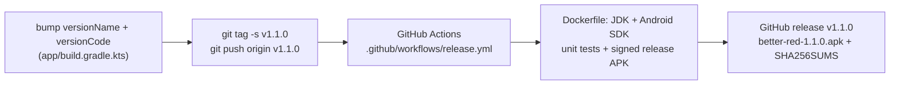

# Releasing

Releases are built in a container from the `Dockerfile` (no Android Studio needed) and published
by GitHub Actions when a version tag is pushed.



## The signing key (once)

Android only installs an update if it's signed with **the same key** as the installed app. Make
the key once, keep it forever, and back it up somewhere safe (a password manager, an offline
drive). If it's lost, nobody can update the app; they'd have to uninstall it (losing their data
unless they export a backup first) and install again.

```bash
keytool -genkeypair -keystore better-red.jks -alias better-red \
  -keyalg RSA -keysize 4096 -validity 10000 -dname "CN=Better Red"
```

(`keytool` comes with any JDK, including Android Studio's: `…/jbr/bin/keytool`.) Keep the file
**outside** the repo, or at least never commit it: `*.jks`, `*.keystore` and `keystore.properties`
are git-ignored.

Then add the repository secrets on GitHub → Settings → Secrets and variables → Actions:

| secret | value |
|---|---|
| `ANDROID_KEYSTORE_BASE64` | `base64 -w0 better-red.jks` (the whole output) |
| `ANDROID_KEYSTORE_PASSWORD` | the keystore password |
| `ANDROID_KEY_ALIAS` | `better-red` |
| `ANDROID_KEY_PASSWORD` | only if the key's password differs from the keystore's |

## Making a release

1. In `app/build.gradle.kts`: set `versionName` (what people see, e.g. `"1.1.0"`) and **raise
   `versionCode` by 1** (Android refuses an update whose code isn't higher).
2. Commit, then tag and push:

   ```bash
   git commit -S -am "Release 1.1.0"
   git tag -s v1.1.0 -m "v1.1.0"
   git push origin main v1.1.0
   ```

3. The **Release** workflow:
   - checks the tag is `v` + `versionName` (otherwise it stops),
   - builds the `Dockerfile` with the signing key as build secrets (never stored in an image layer;
     the decoded key file is deleted afterwards), runs the unit tests, builds the release APK,
   - creates the GitHub release "Better Red 1.1.0" with generated notes, the signing certificate's
     SHA-256, and uploads `better-red-1.1.0.apk` and `SHA256SUMS`.

   A tag with a `-` (`v1.1.0-rc1`) becomes a pre-release. The website's download button
   (`better-red.brutt.site`) points to this releases page.

If it fails, fix it, delete the tag (`git push --delete origin v1.1.0 && git tag -d v1.1.0`) and tag
again. If a release was already created, delete it on GitHub first.

## Building the APK yourself

Needs podman or docker, nothing else.

```bash
make help                     # list the targets
make version                  # the versionName
make apk                      # unsigned: dist/better-red-<version>-unsigned.apk (can't be installed)
make apk KEYSTORE=~/keys/better-red.jks KEY_ALIAS=better-red     # signed: asks for the password
```

`dist/` then holds the APK, `SHA256SUMS` and (signed builds) `signing-certificate.txt`. The first
build downloads the JDK image, the Android SDK and Gradle's dependencies (a few GB, several
minutes); later builds reuse the cached layers.

Without the container, a signed build also works from the terminal or Android Studio with
environment variables (`BR_KEYSTORE_FILE`, `BR_KEYSTORE_PASSWORD`, `BR_KEY_ALIAS`,
`BR_KEY_PASSWORD`) or a git-ignored `keystore.properties` in the project folder:

```properties
storeFile=/home/you/keys/better-red.jks
storePassword=…
keyAlias=better-red
keyPassword=…
```

then `./gradlew assembleRelease` → `app/build/outputs/apk/release/app-release.apk`.

## Keeping the build image current

The `Dockerfile` pins the Android command-line tools (with their SHA-256), the SDK platform
(`platforms;android-37.0`, matching `compileSdk`) and the build tools (`build-tools;36.0.0`). When
`compileSdk` or AGP changes, update those `ARG`s too; Gradle's error message names the missing
package if they fall behind.

## Checking a downloaded APK

```bash
sha256sum -c SHA256SUMS
apksigner verify --print-certs better-red-1.1.0.apk   # compare with the release notes
```
